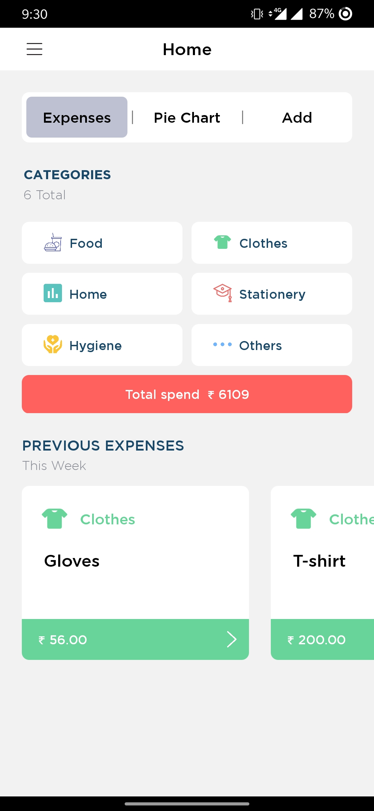
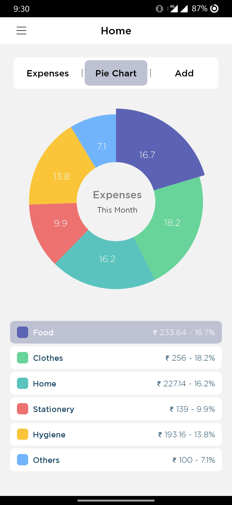
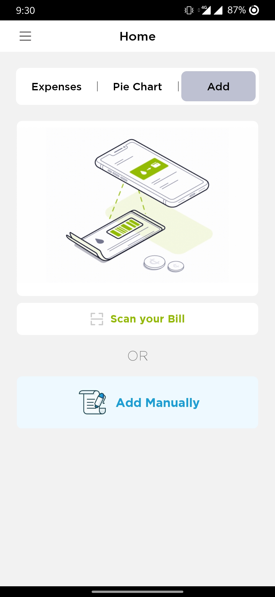
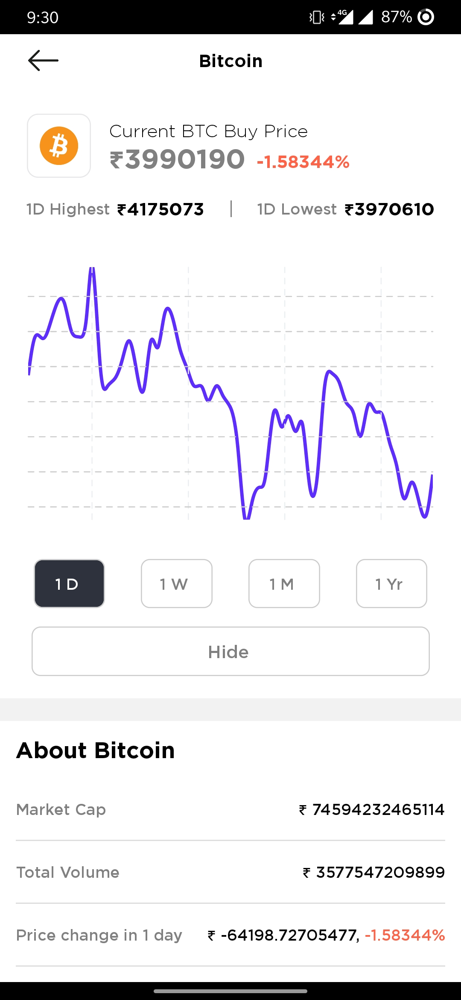

<div align="center">

# Finance Tracker

Expenses, the Indian stock market and crypto prices in one React Native app.

     

</div>

<table>
  <tr><th>Expenses</th><th>Pie chart</th><th>Add expense</th></tr>
  <tr><td></td><td></td><td></td></tr>
</table>

## About

This is the React Native CLI rewrite of the [Expo-based Finance Tracker](https://github.com/neelbavarva/finance-tracker) hackathon app, with a redesigned interface and new market and crypto sections. Track where your money goes by category, add expenses by scanning a bill or typing them in, follow the Sensex and Nifty 50, and check cryptocurrency prices, all from one drawer-based app.

## Screenshots

| Crypto home | Top 100 | Coin details |
| :---: | :---: | :---: |
|  |  |  |

## Features

- **Expenses**: spending grouped into categories, this month's total and cards for recent purchases
- **Pie chart**: a category-wise breakdown of this month's spending
- **Add an expense**: scan a bill with the camera or gallery, or add it manually
- **Market**: Sensex 30 and Nifty 50 overviews, top movers, and company details with price charts
- **Crypto**: trending coins, the top 100 by market cap with search, coin charts for 1 day to 1 year, BTC exchange rates and a Bitcoin explainer
- **Profile**: monthly income, savings target and this month's status

## Tech Stack

| Area | Technology |
| --- | --- |
| App | React Native 0.64, React 17 |
| Navigation | React Navigation (drawer) |
| Charts | Victory Native, react-native-chart-kit |
| Market data | Yahoo Finance API via RapidAPI |
| Crypto data | CoinGecko API |
| Bill scanning | react-native-image-picker, Cloudinary, OCR service from the [Expo version](https://github.com/neelbavarva/finance-tracker) |

## Getting Started

**Prerequisites:** a [React Native development environment](https://reactnative.dev/docs/environment-setup) for Android (Node.js, JDK and Android Studio) and a [RapidAPI](https://rapidapi.com/apidojo/api/yahoo-finance1) key for Yahoo Finance

1. Create `StockApiKey.js` in the project root. It is listed in `.gitignore`, so your key stays out of Git:

   ```js
   export const key = "your-rapidapi-key";
   ```

2. Install dependencies and run the app:

   ```bash
   npm install
   npx react-native run-android
   ```

Bill scanning also needs the OCR service from the Expo version running. Set its URL in `components/Home/AddProduct/ScanBill.js`. Expense data comes from the sample data in `data.js`.

## Project Structure

```
.
├── App.js               # drawer navigation
├── screens/             # Home, Profile, Market, Crypto, About, company and index screens
├── components/
│   ├── Home/            # expenses, pie chart, add expense and bill scanning
│   ├── Market/          # Sensex, Nifty and top movers
│   └── Crypto/          # top 100, exchange rates and Bitcoin explainer
├── data.js              # sample expense and profile data
└── assets/              # images, icons, fonts and README screenshots
```
